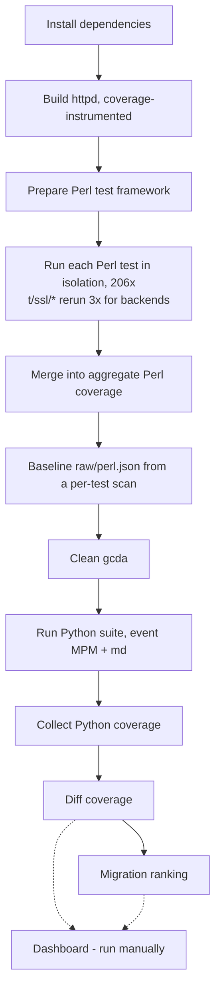

# httpd-testsuites-analysis

Compares code coverage between Apache httpd's two test suites — the
Perl suite (`httpd-tests`) and the newer Python suite (`pyhttpd`, inside
`httpd/test/modules`) — to see how much they overlap and which Perl
tests are worth porting first. Includes a Streamlit dashboard.

## Quick start

Most people want one of these two, not a full local pipeline run.

**See the latest results** — trigger `coverage.yml` from the Actions
tab (or grab an existing successful run), download its
`coverage-<run-id>` artifact, unzip into `coverage/`, then:

    uv sync
    uv run streamlit run coverage/tools/dashboard.py

No streamlit? `uv run python3 coverage/tools/print_summary.py` prints
the same headline numbers, migration ranking, and per-run test
pass/fail counts as plain text.

**Run the whole pipeline yourself** — budget a few hours, since the
Perl suite runs 206 times (once per test file). See "Full local
pipeline" below for prerequisites and every step, or just read
`.github/workflows/coverage.yml`, which runs the same steps end to end.

## Full local pipeline

Prerequisites

- Linux (tested on Fedora 44)
- gcc with gcov
- Python 3.9+ and [uv](https://docs.astral.sh/uv/)
- Perl with cpanm
- APR / APR-util dev headers
- Go (to build pebble, for mod_md's ACME tests)

Fedora system packages:

    sudo dnf install autoconf automake perl-App-cpanminus libtool libtool-ltdl-devel \
        apr-devel apr-util-devel openssl-devel lua-devel brotli-devel \
        libcurl-devel libnghttp2-devel jansson-devel pcre2-devel \
        libxml2-devel cyrus-sasl-devel gdb perl-doc nghttp2 curl \
        check-devel python3-pip expat-devel php-fpm

I needed this to get `buildconf` working on Fedora 44 — `apr-devel`
ships `apr_common.m4`/`find_apr.m4` under `/usr/share/aclocal/`, but
`buildconf` looks for them in `apr-1-config`'s own build dir:

    sudo mkdir -p /usr/lib64/apr-1/build
    sudo ln -s /usr/share/aclocal/apr_common.m4 /usr/lib64/apr-1/build/
    sudo ln -s /usr/share/aclocal/find_apr.m4 /usr/lib64/apr-1/build/
    sudo ln -s /usr/share/aclocal/find_apu.m4 /usr/lib64/apr-1/build/

Perl CPAN modules:

    cpanm --local-lib=~/perl5 local::lib && eval $(perl -I ~/perl5/lib/perl5/ -Mlocal::lib)
    cpanm --notest LWP::Protocol::https \
        LWP::Protocol::AnyEvent::http ExtUtils::Embed Test::More \
        AnyEvent DateTime HTTP::DAV FCGI \
        AnyEvent::WebSocket::Client Apache::Test

(`Net::SSL` doesn't build on OpenSSL 3.x — `LWP::Protocol::https` covers
the same need.)

Python environment:

    uv sync

Installs this repo's own tools (`gcovr`, `streamlit`, `pandas`, `altair`)
plus pyhttpd's test dependencies. Prefix commands below with `uv run`,
or `source .venv/bin/activate` once.

Setup and build

    git clone https://github.com/apache/httpd.git
    git clone https://github.com/ichristod/httpd-testsuites-analysis.git
    git clone https://github.com/apache/httpd-tests.git

    export PREFIX=$HOME/build/httpd
    export HTTPD_ROOT=$HOME/opensource/httpd
    export PERL_FRAMEWORK=$HOME/opensource/httpd-tests
    export ANALYSIS_ROOT=$HOME/opensource/httpd-testsuites-analysis

    mkdir -p coverage/{raw,processed,metrics,lcov,per_test}

Build httpd with coverage instrumentation:

    rm -rf $PREFIX   # if switching branches, so no stale modules linger
    cd $HTTPD_ROOT
    ./buildconf --with-apr=/usr/bin/apr-1-config
    ./configure --prefix=$PREFIX \
        --enable-mods-shared=reallyall \
        --with-mpm=event \
        --enable-mpms-shared=all \
        --enable-load-all-modules \
        --with-apr=/usr \
        --with-apr-util=/usr \
        CFLAGS="-g -O0 --coverage" \
        LDFLAGS="--coverage"
    make -j$(nproc)
    make install

`./configure` leaves behind `a-conftest.gcno` with no matching source,
which crashes gcovr. Remove it once:

    rm -f $HTTPD_ROOT/a-conftest.gc*

Collect Perl suite coverage (per-test)

Coverage comes from running each `.t` file individually and unioning
the results — not one accumulated run — so the overlap comparison and
the migration ranking are built from the same measurement.

    eval $(perl -I ~/perl5/lib/perl5/ -Mlocal::lib)
    cd $PERL_FRAMEWORK
    perl Makefile.PL -apxs $PREFIX/bin/apxs
    cd $ANALYSIS_ROOT
    coverage/tools/create_per_test.sh

Results land in `coverage/per_test/perl/{raw,norm}/`.

`t/ssl/*` reruns 3x, once per session-cache backend (`shmcb`, `redis`,
`memcache`), accumulating coverage across the three — needs redis and
memcached reachable at `localhost:6379`/`localhost:11211`.

`t/modules/ldap.t` needs a real LDAP server. This repo reuses upstream
httpd's own CI setup for it:

    docker build -t httpd_ldap -f "$HTTPD_ROOT/test/travis_Dockerfile_slapd.centos" "$HTTPD_ROOT/test/"
    cd $PERL_FRAMEWORK && ./scripts/ldap-init.sh

**Expected test failures** — these need external services not set up
by default, so seeing exactly these is a working run, not a regression:

- `t/ssl/*` — without redis/memcached, falls back to the default
  (`shmcb`) backend only.
- `t/modules/ldap.t` — skips if you don't run the LDAP seeding steps
  above (CI always does; a manual local run might skip them).
- `t/apache/snihostcheck.t`, `t/modules/proxy_websockets_ssl.t` — need
  HTTPS, same as the SSL tests.
- `t/protocol/echo.t` — needs a backend echo server.
- `t/security/CVE-2005-2700.t`, `t/security/CVE-2009-3555.t` — SSL
  renegotiation, same dependency.
- `t/php/*` — skipped without php-fpm (`sudo dnf install php-fpm`).
- `t/protocol/nntp-like.t` — skipped on Linux (deferred accept).

Matches upstream httpd's own "Default" CI job, which doesn't set up SSL
backends either and only runs PHP tests when php-fpm is present.

Merge the per-test results into the aggregate (`perl.norm.json`):

    python coverage/tools/analyze_per_test.py \
        coverage/per_test/perl/norm \
        --merged-json coverage/processed/perl.norm.json

Also prints a greedy set-cover ranking of all Perl tests to stdout.

Any per-test raw scan works as a full-suite `coverage/raw/perl.json`
baseline (`.gcno` is the same across every scan — only hit counts
differ):

    cp coverage/per_test/perl/raw/apache__headers.json coverage/raw/perl.json

Clean gcov data before the other suite:

    coverage/tools/clean_gcda.sh

Collect Python suite coverage

`--enable-mpms-shared=all` builds every MPM as a loadable module, so
`pyhttpd` can run under any of them without a rebuild — just set `$MPM`:

    MPM=event pytest test/modules/core test/modules/http1 \
        test/modules/http2 test/modules/proxy test/modules/aaa \
        test/modules/metadata

Only `event` runs in `coverage.yml`. The Perl suite's build is fixed at
`--with-mpm=event` and never varies per test, so running Python under
`worker`/`prefork`/`motorz`/`simple` as well doesn't make Python's
testing look better — it just gives Python coverage credit for
MPM-dispatch code Perl could never reach either way. Tried running the
other four MPMs too for one real run (see git history); dropped them to
keep both suites on the same MPM.

Check `git log` on `test/modules/` before assuming the directory list
above is exhaustive — pyhttpd adds new top-level dirs over time.

**mod_md** — `test/modules/md` runs too, same tree, no gcda cleaning in
between. Genuinely timing-sensitive against a live ACME server, so it
runs with `continue-on-error` and a tight timeout in CI — a partial
failure just means partial coverage from that run, not a broken
pipeline.

Needs `pebble` on `$PATH`:

    go install github.com/letsencrypt/pebble/v2/cmd/pebble@latest
    go install github.com/letsencrypt/pebble/v2/cmd/pebble-challtestsrv@latest

Also needs `a2md` in `$PREFIX/bin` (builds automatically from
`support/a2md/` on recent httpd; on older checkouts without
`support/a2md/`, those tests just skip).

`test/gen/` must be fresh — pebble generates a new CA each start, and a
stale `test/gen/` makes `a2md` distrust it:

    rm -rf $HTTPD_ROOT/test/gen
    MPM=event pytest test/modules/md/ || true

A few failures are expected, not environment issues: status checks on
`MDRenewMode manual` domains with no issued cert fail verification
against mod_md's self-signed fallback; `apache_stop()`'s 10s shutdown
timeout occasionally fires early, leaving httpd bound to test ports for
the next file (shows up as "Address already in use" — kill the
leftover process and rerun that file).

**Collect coverage** — one `gcovr` pass covers everything that ran
against this `$HTTPD_ROOT`:

    gcovr -r $HTTPD_ROOT \
        --gcov-ignore-errors output_error \
        --gcov-ignore-errors no_working_dir_found \
        --gcov-ignore-parse-errors all \
        --merge-mode-functions=merge-use-line-min \
        --json coverage/raw/python.json

    python coverage/tools/normalize_gcovr.py \
        coverage/raw/python.json \
        coverage/processed/python.norm.json

Coverage diff and migration ranking

    python coverage/tools/coverage_diff.py \
        coverage/processed/perl.norm.json \
        coverage/processed/python.norm.json \
        coverage/metrics/perl_only.json

Swap the two inputs to get Python-only lines instead.

Migration ranking scores Perl tests by how much of the gap (lines Perl
covers that Python doesn't) each one closes, using the per-test data
already collected — no second Perl run:

    python coverage/tools/analyze_consolidation.py \
        coverage/per_test/perl/norm \
        coverage/processed/python.norm.json \
        --json coverage/per_test/perl/consolidation_ranking.json

Optional — check the ranking isn't just an artifact of tie-breaking, by
re-running it two more ways and comparing:

    python coverage/tools/compare_ranking_robustness.py \
        coverage/per_test/perl/norm \
        coverage/processed/python.norm.json

## Dashboard

    uv run streamlit run coverage/tools/dashboard.py

Five tabs: Overview, Python Focus, Perl Focus, Shared Infrastructure,
Consolidation.

## Running the whole pipeline in CI

`.github/workflows/coverage.yml` runs everything above end to end in one
job. Trigger manually from the Actions tab (`workflow_dispatch`,
optional `httpd_ref`, defaults to `trunk`) and download the
`coverage-<run-id>` artifact. Budget a couple of hours — the 206-test
Perl loop dominates.

## Scripts

| Script | Purpose |
|--------|---------|
| `coverage/tools/normalize_gcovr.py` | Strips raw gcovr JSON down to `{file: [lines]}` |
| `coverage/tools/clean_gcda.sh` | Wipes `.gcda` to reset counters |
| `coverage/tools/coverage_diff.py` | Lines in suite A but not B |
| `coverage/tools/merge_coverage.py` | Unions any number of normalized coverage files |
| `coverage/tools/create_per_test.sh` | Runs each Perl test individually, collects coverage |
| `coverage/tools/analyze_per_test.py` | Greedy ranking of Perl tests; `--merged-json` builds `perl.norm.json` |
| `coverage/tools/analyze_consolidation.py` | Migration priority ranking (gap-scoped) |
| `coverage/tools/compare_ranking_robustness.py` | Re-runs the ranking 3 ways to sanity-check it |
| `coverage/tools/config.py` | Shared tunable values (infra threshold, dashboard labels) |
| `coverage/tools/dashboard.py` | Streamlit dashboard |
| `coverage/tools/print_summary.py` | Headline numbers, test pass/fail counts, and migration ranking as plain text, no streamlit needed |

Notes worth knowing before changing any of these:

- **`create_per_test.sh`** only isolates gcov counters, not the
  filesystem — a test could in principle leave state for the next one.
  Not fully audited across all 206 tests.
- **`analyze_consolidation.py`**: a test showing `new_lines: 0` means
  some other Perl test already claims the same gap lines — not that
  Python covers it. The 25% "infrastructure" cutoff is a judgment call —
  it lives in `coverage/tools/config.py` (`FREQ_THRESHOLD`), read by
  `analyze_consolidation.py`, `compare_ranking_robustness.py`,
  `dashboard.py`, and `presentation/coverage_stats.py`, so changing it
  only needs editing one file instead of five. It's a pure analysis
  parameter, not a collection one — changing it doesn't need a CI rerun,
  just re-running these scripts locally against an already-downloaded
  artifact. `--rank-mode {current,frequency,path}` (default `current`)
  exists for `compare_ranking_robustness.py` to sanity-check the
  ranking; the main pipeline always uses `current`.
- **`dashboard.py`** computes everything live from the JSON files, no
  caching to disk. The "untested code" breakdown on the Shared
  Infrastructure tab is aggregate-only on purpose — no per-file "least
  tested" leaderboard.
